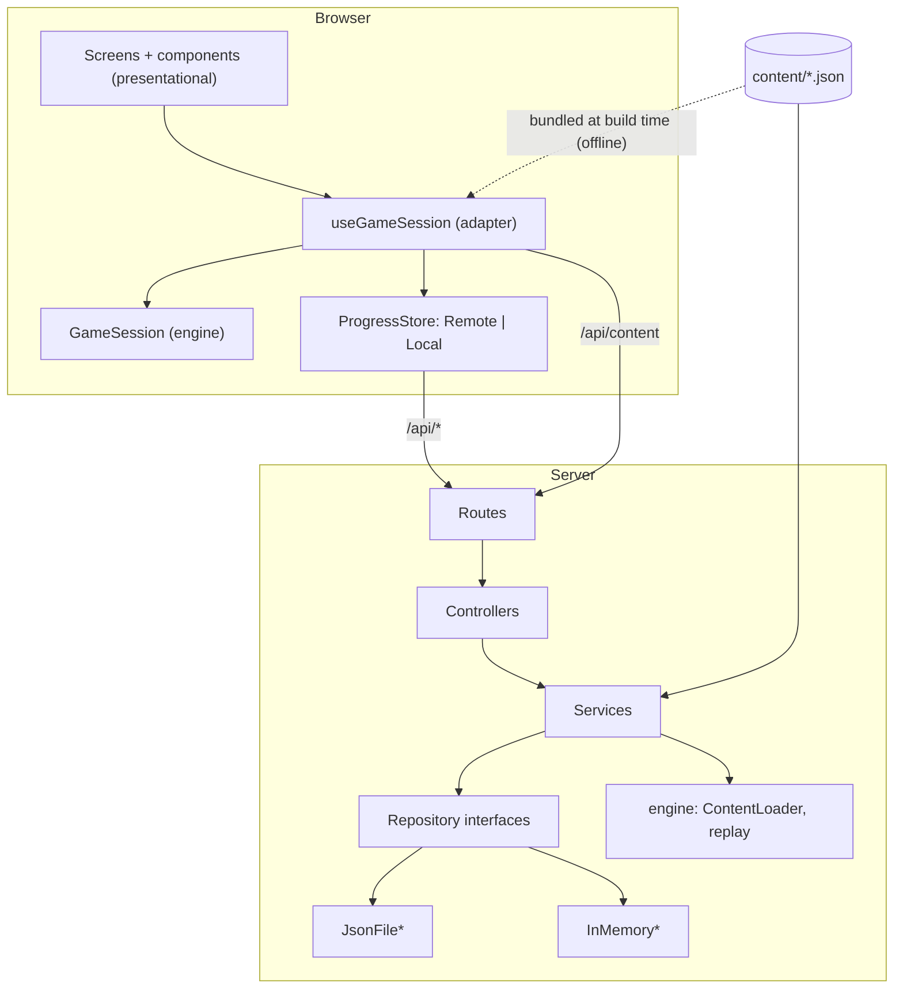
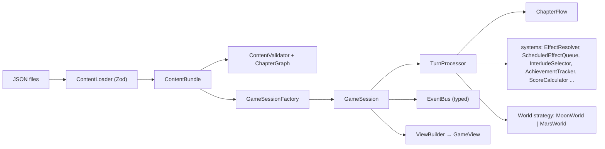
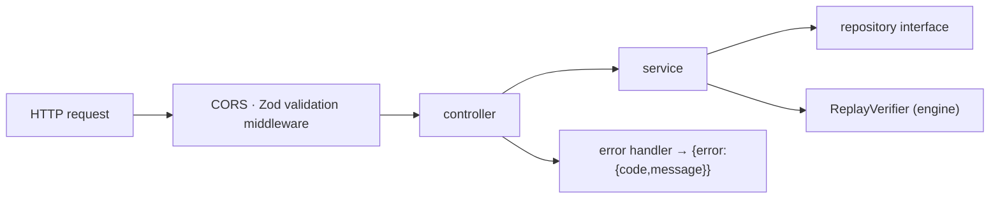

# Architecture

COMMANDER is an npm-workspaces monorepo with one rule at its centre: **the game rules live in a pure TypeScript engine; everything else (server, browser UI, scripts) is a thin adapter around it.**

```
content/ (JSON story data) ──► packages/engine (pure rules) ◄── client (React UI)
                                       ▲                      ◄── server (Express API)
                                       └── scripts (validate / graph / schema)
```

## Layers

| Layer   | Folder            | Knows about         | Never touches                                                                       |
| ------- | ----------------- | ------------------- | ----------------------------------------------------------------------------------- |
| Content | `content/`        | nothing (JSON only) | code                                                                                |
| Engine  | `packages/engine` | Zod, itself         | React, DOM, Express, `Math.random`, `Date.now`, `localStorage` (enforced by ESLint) |
| Server  | `server/`         | engine, Express     | React                                                                               |
| Client  | `client/`         | engine, React       | Express                                                                             |
| Tooling | `scripts/`        | engine, Node `fs`   |                                                                                     |



## Engine (`packages/engine`)



Folders: `domain/` (ids, view models, events, commands, snapshot types), `content/` (Zod schemas, loader, validator, graph, Mermaid exporter), `narrative/` (campaign, chapter runner, conditions, node resolver, templater, flags), `systems/` (resources, clock, queues, interludes, achievements, score, ARIA), `worlds/` (strategies), `session/` (the orchestrator and its helpers), `events/`, `random/`. `src/index.ts` is the only public entry point.

### Patterns and where they live

| Pattern                  | Where                                                                   | Why                                                                                                                                                                                                                                           |
| ------------------------ | ----------------------------------------------------------------------- | --------------------------------------------------------------------------------------------------------------------------------------------------------------------------------------------------------------------------------------------- |
| **Strategy**             | `worlds/world.ts`, `MoonWorld`, `MarsWorld`, `createWorld`              | Worlds differ in daily rules, chips and timeline. A new world = one class + one JSON file + one `case` in `world-registry.ts`.                                                                                                                |
| **Observer**             | `events/event-bus.ts`; `GameSession.events`                             | The engine emits `ResourceChanged`, `DayAdvanced`, `StickerRaised`, `FactLogged`, `NodePresented`, `ChapterStarted`, `ChapterEnded`, `MissionEnded`, `AchievementUnlocked`, `PhaseChanged`. React subscribes; the engine never calls UI code. |
| **Repository**           | `server/src/repositories/interfaces`                                    | All persistence is behind async interfaces.                                                                                                                                                                                                   |
| **Factory**              | `GameSessionFactory`, `RepositoryFactory`                               | Wiring in one place.                                                                                                                                                                                                                          |
| **Command**              | `domain/commands.ts` (`choose`, `proceed`)                              | Every input is serialisable, so a run can be replayed.                                                                                                                                                                                        |
| **Memento**              | `SessionSnapshot` (`GameSession.snapshot/restore`), chapter checkpoints | Save/resume and "retry chapter".                                                                                                                                                                                                              |
| **Dependency injection** | `SessionContext`, constructors everywhere                               | Time and randomness are injected (`SeededRandom`).                                                                                                                                                                                            |

### Determinism

All randomness goes through `SeededRandom` (mulberry32). The same seed plus the same command list always produces the same run and the same score. The RNG state is part of the snapshot, so resuming mid-run is also exact.

### The turn (`TurnProcessor.choose`)

The order mirrors the original prototype:

1. resolve the choice (gamble rolled with the seeded RNG) and apply flags;
2. apply immediate resource effects (clamped 0..100) and raise gamble stickers;
3. queue `later` effects (`day + in + days - 1`), follow-up cards (`next`, `winNext`);
4. log the fact (unique, newest first), count the card;
5. resolve the `goto` (first matching branch wins);
6. if any resource is 0, end the chapter with its `resourceFailure`;
7. for each day the choice costs: advance the clock; in **simulated** chapters apply the world drain × difficulty multiplier, the world's own rules (Moon night/day power, Mars storms), the −0.8 health penalty per non-health resource below 20, supply drops, then deliver due delayed effects; emit `DayAdvanced` and phase changes;
8. check achievements; in simulated chapters check the goal day and roll a random event (8%, after day 4);
9. hand over to `ChapterFlow` for the next card: an interlude, the next story node, or a chapter ending.

### Chapters, endings and retries

`ChapterFlow` owns transitions. An ending's `outcome` is `advance` (next chapter, keeping state and flags), `retry` (restore the chapter-start checkpoint, count a retry) or `missionEnd`. The difficulty's `retryLimit` caps retries per chapter (`null` = unlimited); exhausting it ends the mission with a report. Chapter checkpoints keep resources, flags, queues and the clock; field notes, badges and the RNG are deliberately **not** rolled back.

## Content pipeline

`content/` is loaded through `ContentLoader.load(filesMap)`, which is filesystem-free: the server feeds it files read from disk (`IContentSource`), the client feeds it files bundled by `import.meta.glob` (offline) and `scripts/` read the folder. Schemas are strict (typos fail), and `ContentValidator` adds the graph checks described in [STORY_AUTHORING.md](./STORY_AUTHORING.md). `npm run content:schema` turns the Zod schemas into JSON Schemas for editor autocomplete; `npm run content:graph` writes Mermaid diagrams to [`docs/graphs/`](./graphs).

## Server (`server/`)



`app.ts` builds the Express app from injected dependencies (no `listen`, so Supertest can use it); `server.ts` is the entry point; `composition-root.ts` is the **only** place that chooses concrete implementations, driven by `STORAGE_DRIVER=json|memory`.

### Adding a storage driver (for example Cosmos or SQL)

1. Add the driver name to `STORAGE_DRIVERS` in `server/src/config/env.ts`.
2. Create one class per interface (`IPlayerRepository`, `IProgressRepository`, `ILeaderboardRepository`) in `server/src/repositories/<driver>/`.
3. Add one `case` to `RepositoryFactory.create`. The `never` check in `default` makes the build fail until every driver is handled.
4. Add connection settings to the typed env config.

Nothing else changes: services, controllers, routes and tests only know the interfaces. `JsonFile*` repositories write atomically (temp file then rename) through a per-file queue; `InMemory*` repositories back the tests.

## Save and replay model

- **Save:** after every choice and chapter end the client sends `session.snapshot()` (a JSON memento containing the seed, command log, full state and the chapter checkpoint) to `PUT /api/progress/:playerId/:runId`, or to `localStorage` when offline. **Continue** loads it back with `GameSessionFactory.restore`.
- **Leaderboard:** the client submits only `{ playerId, runId, seed, world, difficulty, commands }`. The server **replays** the commands with the engine and takes the score from the resulting mission report; a submitted `score` is rejected, invalid or unfinished replays get `422`.

## Client (`client/`)

- `game/useGameSession` adapts the synchronous engine to React: it subscribes to `session.events`, calls `choose`, then **plays the events back** with the prototype's timings (fly-out, per-day pauses, stickers). `?fast` zeroes every delay.
- `app/` holds a typed screen state machine (`landing → select → chapterIntro → game → chapterResult → missionReport`).
- `themes/` implements swappable themes; see [THEMING.md](./THEMING.md). Components are presentational and read class recipes through `useTheme()`; they never branch on the theme id.
- `api/` is a typed fetch wrapper plus a content source that falls back to the bundled content, so the game plays offline (an OFFLINE chip is shown and progress goes to `localStorage` behind the same `ProgressStore` interface).
