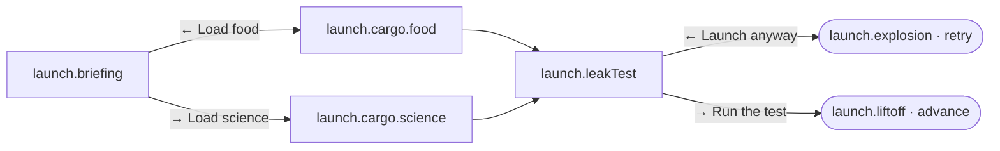

# Story Authoring Guide

This guide is for teammates who write story content. **You never need to touch code**: every chapter, node, ending and side-card is a JSON file under [`content/`](../content).

- [The model](#the-model)
- [Folder layout](#folder-layout)
- [Copy-paste templates](#copy-paste-templates)
- [Reference: choices, `goto`, `when`, flags](#reference)
- [Delayed consequences](#delayed-consequences)
- [Merging branches safely](#merging-branches-safely)
- [Survival chapters and interludes](#survival-chapters-and-interludes)
- [Rules of good content](#rules-of-good-content)
- [Naming conventions](#naming-conventions)
- [Workflow](#workflow)
- [Common validator errors and fixes](#common-validator-errors-and-fixes)

## The model

A **campaign** is an ordered list of **chapters** per world. A **chapter** is a small branching graph:
every **node** is a card with two options (left / right) and each option points (`goto`) at the next node
or at an **ending**. An ending decides what happens to the campaign: `advance` (next chapter), `retry`
(replay the chapter) or `missionEnd` (the mission is over).



Resources (`P` Power, `F` Food, `W` Water, `R` Shielding, `M` Morale, `C` Comms, `H` Health) are shared
across chapters. A resource at **0** ends the chapter with the `resourceFailure` ending. **Flags**
are yes/no memories (`skippedLeakTest`) that survive across chapters and can change text, branches and
side-cards later.

## Folder layout

```
content/
  campaign/
    campaign.json                 ordered chapter ids per world + human labels for flags
    chapters/<chapter-id>/
      chapter.json                metadata, start node, endings, interlude settings
      nodes/*.json                story nodes, one file per storyline branch
    interludes/*.json             reusable survival side-cards
  characters.json  resources.json  worlds/*.json  difficulties.json
  achievements.json  facts-and-tips.json  config.json
  schema/                         generated JSON Schemas (autocomplete in VS Code)
```

The chapter folder name must equal the chapter `id`. Adding a node file needs **no code change**.

## Copy-paste templates

### `chapter.json`

```jsonc
{
  "$schema": "../../../schema/chapter.schema.json",
  "id": "ch0-launch-day",
  "title": "Launch Day",
  "worlds": ["moon", "mars"],
  "goal": "Load the ship correctly and lift off.",
  "startNode": "launch.briefing",
  "clock": { "startDay": -3, "unitOverride": "day" },
  "endings": {
    "launch.liftoff": {
      "outcome": "advance",
      "title": "LIFTOFF",
      "text": "The engines roar and the Earth falls away.",
      "setFlags": ["cleanLaunch"],
    },
    "launch.explosion": {
      "outcome": "retry",
      "title": "VEHICLE LOST",
      "text": "A tiny leak became a big problem.",
      "lesson": "Leak checks exist for a reason.",
    },
  },
  "resourceFailure": { "outcome": "retry", "title": "SYSTEMS COLLAPSED" },
  "interludes": null,
}
```

### A node file (`nodes/fuel-loading.json`)

```jsonc
{
  "$schema": "../../../../schema/nodes.schema.json",
  "nodes": [
    {
      "id": "launch.fuel.leak",
      "speaker": "eng",
      "tag": "LAUNCH",
      "text": "Sensors show a tiny pressure drop in the oxidizer line. A full leak test costs a {D}.",
      "variants": [
        {
          "when": { "flags": ["damagedHull"] },
          "text": "Another pressure drop. After last time, I don't like it.",
        },
      ],
      "fact": "Many launch scrubs are caused by sensor readings or small leaks.",
      "left": {
        "label": "Launch anyway",
        "days": 0,
        "effects": { "M": 4 },
        "setFlags": ["skippedLeakTest"],
        "goto": "launch.countdown",
      },
      "right": {
        "label": "Run the test",
        "days": 1,
        "effects": { "P": -4, "M": -3 },
        "goto": "launch.fuel.found",
      },
    },
  ],
}
```

## Reference

### Fields of a node

| Field            | Meaning                                                                                                                            |
| ---------------- | ---------------------------------------------------------------------------------------------------------------------------------- |
| `id`             | Unique within the chapter. Nodes and endings share one id namespace.                                                               |
| `speaker`        | Character id from `characters.json` (`eng`, `sci`, `ops`, `med`, `com`, `bot`, `ls`, `hq`, `psy`, `rook`, `aria`, `arch`, `cook`). |
| `tag`            | Small label on the card (`LAUNCH`, `TRANSIT`…).                                                                                    |
| `text`           | 1–2 short sentences. May use `{D}` (day/sol), `{Ds}` (days/sols), `{P}` (planet).                                                  |
| `variants`       | Optional list of `{ when, text }`. The first match replaces `text`.                                                                |
| `fact`           | **Required.** One real, kid-friendly fact. It becomes a Field Note.                                                                |
| `left` / `right` | The two options.                                                                                                                   |

Text, fact and a whole option can be per-world: `"text": { "moon": "…", "mars": "…" }`. Every world the
chapter lists in `worlds` must then have a key.

### Fields of an option (`left` / `right`)

| Field                     | Meaning                                                                                                                            |
| ------------------------- | ---------------------------------------------------------------------------------------------------------------------------------- |
| `label`                   | Button and stamp text. Keep it short (1–3 words).                                                                                  |
| `days`                    | Days the choice takes. Default `1`; `0` = no time; can be `{ "moon": 2, "mars": 4 }`.                                              |
| `effects`                 | Immediate resource changes, e.g. `{ "P": -4, "M": 3 }` (typical size ±2…±15).                                                      |
| `setFlags` / `clearFlags` | Flags to set or clear (camelCase).                                                                                                 |
| `gamble`                  | `{ "p": 0.6, "win": {…}, "lose": {…}, "winText": "ICE FOUND!", "loseText": "ROVER DAMAGED", "winGoto"?, "loseGoto"?, "winNext"? }` |
| `later`                   | Delayed effect: `{ "in": 3, "effects": {…}, "message": "RECYCLER FAILED" }`.                                                       |
| `next`                    | Queue a follow-up side-card: `{ "id": "ice2", "in": 4 }` (survival chapters).                                                      |
| `sci`                     | `true` counts toward the CURIOUS MIND badge.                                                                                       |
| `goto`                    | Where the story goes next (see below).                                                                                             |

### `goto`

- `"node.id"`: the next node.
- `"ending.id"`: end the chapter.
- `"$interludes"`: survival chapters only. Keep drawing side-cards until the goal day.
- A conditional list, **first match wins**. End with an unconditional branch:

  ```json
  "goto": [
    { "when": { "flags": ["skippedLeakTest"] }, "to": "launch.explosion" },
    { "to": "launch.liftoff" }
  ]
  ```

- With a `gamble`, `winGoto` / `loseGoto` override `goto` for that outcome.

Flags set by the choice are applied **before** its `goto` is evaluated.

### `when` conditions

Used by `variants`, conditional `goto` and interlude eligibility. Every field is optional and they are AND-ed.

| Field                             | Meaning                                             |
| --------------------------------- | --------------------------------------------------- |
| `flags`                           | all of these flags must be set                      |
| `notFlags`                        | none of these may be set                            |
| `anyFlags`                        | at least one must be set                            |
| `world`                           | a world id or list of ids                           |
| `minDay` / `maxDay`               | day range (inclusive)                               |
| `resourceAbove` / `resourceBelow` | e.g. `{ "W": 30 }` means water is strictly above 30 |
| `chapterRetries`                  | retries used in this chapter is at least N          |

### Endings

`outcome` is `advance`, `retry` or `missionEnd`. Optional: `lesson`, `setFlags`, `carryEffects`
(resource change carried into the next chapter), and for `missionEnd` a `result` of `win` (default) or `loss`.
A chapter **must** have at least one `advance` ending (or a winning `missionEnd` in the last chapter).
`resourceFailure` is what happens when any resource hits zero (it uses the death text of that resource).

### Chapter clock

`"clock": { "startDay": 1, "unitOverride": "day", "simulate": true }`. Leave `startDay` out to continue counting from the previous chapter's day (the epilogue does this so the final score reflects the whole mission). Story chapters leave `simulate` off: days
pass and delayed effects land, but there is no daily drain, supply drop or random event. Survival chapters
turn it on.

## Delayed consequences

Flags are the long-term memory of the story. Set one early, use it later:

1. **Chapter 0:** the player launches without a leak test → `"setFlags": ["skippedLeakTest"]`.
2. **Chapter 1:** a node has `variants` that mention the old decision, or a conditional `goto` sends the player down a harder branch.
3. **Survival:** an interlude with `"when": { "flags": ["packedExtraFood"] }` only appears for players who earned it.

Every chapter should contain at least one decision whose consequence shows up **later**.
List readable names for important flags in `campaign.json` → `flagLabels`; they appear in the mission report as "key decisions".

## Merging branches safely

Branches may converge on a shared node (the graph is a DAG, not strictly a tree). When they do:

- set a flag on each incoming branch so the merged node can use `variants` to reflect the path taken;
- never create a loop where every option takes **0 days** (the validator rejects it);
- run `npm run content:graph` and read the diagram in `docs/graphs/`.

## Survival chapters and interludes

A survival chapter sets `"clock": { "simulate": true, "startDay": 1 }` and:

```jsonc
"interludes": {
  "pools": ["colony", "moon", "followup", "injected"],
  "every": [2, 4],
  "goalEnding": "survive.complete"
}
```

Between story nodes the engine draws 2–4 side-cards from those pools (`campaign/interludes/*.json`),
biased toward cards that help the lowest resource. The story spine ends with `"goto": "$interludes"`.
When the world's goal day is reached (Moon day 84, Mars sol 100) the `goalEnding` fires.

Interlude cards use the same fields as nodes plus `pool`, optional `worlds`, `when` and `setFlags`.
A card with `"followUp": true` is only drawn after another card queues it with `next`.
Cards in the `injected` pool are added by world rules (`m_night`, `r_storm`).

## Rules of good content

1. **Two meaningfully different options.** They must lead to a different next node, different flags or a different ending. Never two options with the same result (the validator enforces this).
2. **A `fact` on every node**, real and NASA-grounded, understandable by a kid.
3. **Short text:** 1–2 sentences on the card, 1–3 words on a button.
4. **Consequences, not just numbers.** Prefer a changed branch or flag to another ±5 resource tweak.
5. **Fair failure.** A retry ending should teach something (`lesson`).
6. **Use the cast.** Pick the speaker who would actually say it.

## Naming conventions

- Node ids: `<chapter>.<storyline>.<beat>` such as `launch.fuel.leak`, `touchdown.site.boulders`.
- Ending ids: `<chapter>.<outcome>` such as `launch.liftoff`, `launch.explosion`.
- Flags: `camelCase` verbs or states such as `skippedLeakTest`, `packedExtraFood`.
- Files: one storyline per file, kebab-case (`fuel-loading.json`).
- Chapter folder = chapter id (`moon-ch1-translunar`).

## Workflow

1. Create or edit a JSON file (VS Code autocompletes from `$schema`).
2. `npm run content:validate` and fix every error.
3. `npm run content:graph`, then review `docs/graphs/<chapter>.md` (open the Markdown preview to see the diagram).
4. Playtest with `npm run dev` (add `?fast` to the URL to skip animations).
5. Open a pull request.

## Common validator errors and fixes

| Message                                                      | Fix                                                               |
| ------------------------------------------------------------ | ----------------------------------------------------------------- |
| `unknown speaker "xyz"`                                      | Use an id from `characters.json`.                                 |
| `goto "x" is not a node or ending of this chapter`           | Fix the typo or add the node or ending.                           |
| `node is unreachable from the start node`                    | Point some option at it, or delete it.                            |
| `node has no path to any ending`                             | Make sure every branch eventually reaches an ending.              |
| `cycle where no choice consumes a day`                       | Give at least one option in the loop `days` ≥ 1.                  |
| `both options lead to the same place and set the same flags` | Different `goto`, or set a different flag per option.             |
| `missing variant for world "mars"`                           | A `{ moon, mars }` object needs every world the chapter supports. |
| `flag is read but never set anywhere (typo?)`                | A warning: check the spelling, or add the `setFlags`.             |
| `chapter has no advance ending`                              | Declare an ending with `"outcome": "advance"`.                    |
| `startNode "x" does not exist`                               | Fix `startNode` in `chapter.json`.                                |
| `a chapter with interludes needs "clock.simulate": true`     | Add `"simulate": true` to the clock.                              |
| Unknown key in schema error                                  | Keys are strict; check spelling against the template.             |
